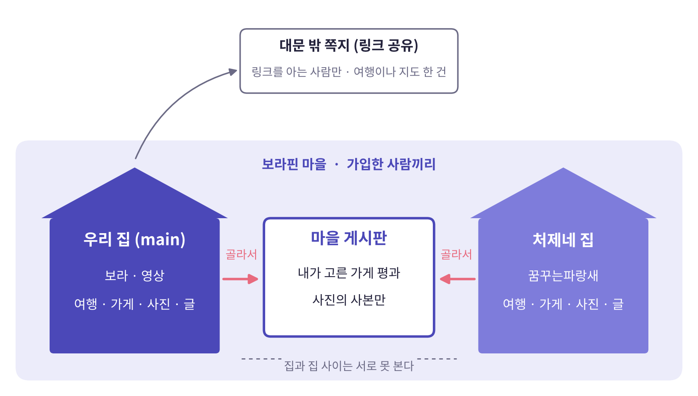
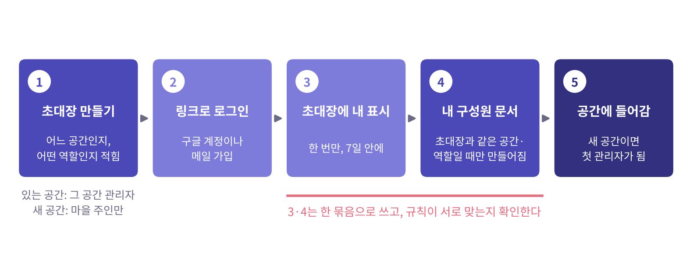
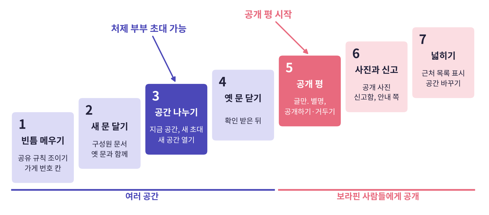

# 보라핀 — 여러 공간과 '보라핀 사람들에게 공개' 설계

작성 2026-11-20 · 상태: 설계 (만들기 전 확인 받을 것은 9절) · 기준 코드: main `c495417`

## 0. 한 장 요약

지금 보라핀은 **집 한 채**다. 문은 하나(`config/access`의 메일 목록)이고, 들어온 사람은 모든 방을 본다. 그래서 처제 부부를 초대하면 우리 기록을 전부 보게 된다.

바꾸려는 모습은 **집이 여러 채 있는 마을**이다.

- **집(공간)**: 부부·가족마다 한 채. 집 안의 기록은 그 집 사람만 본다. 옆집은 물론 마을 주인(영상)도 앱으로는 못 본다.
- **마을 게시판(공개 평)**: 내가 고른 가게 평과 사진만 내다 건다. 보라핀에 가입한 사람끼리만 보고, 인터넷에는 나오지 않는다.
- **대문 밖 쪽지(링크 공유)**: 지금 있는 여행·지도 링크 공유. 그대로 둔다.



핵심 결정 다섯 가지 (추천안으로 정함, 바꾸려면 9절):

| | 정한 것 | 까닭 |
|---|---|---|
| 1 | 구성원은 메일 목록이 아니라 **공간마다 사람 문서**(`spaces/{공간}/members/{uid}`)로 | 목록 하나를 여럿이 고치지 않아도 되고, 규칙이 짧고, 사람 수 제한이 없다 |
| 2 | 새 공간은 **주인이 준 초대장으로만** 연다 | 무료 한도를 지키고, 모르는 사람이 몰려오지 않게 |
| 3 | 실제 기록은 **옮기지 않는다** (`spaces/main` 그대로) | 자료가 이미 공간 아래에 있다. 문만 바꾸면 된다 |
| 4 | 공개는 **항목마다 골라서, 사본으로**. 기본은 우리만 | 원본은 계속 잠겨 있고, 공개를 거두면 사본만 지우면 된다 |
| 5 | **'별로'는 공개하지 않는다**. 얼굴 나온 사진도 올리지 않게 안내 | 가게와 다툴 일, 사람이 드러날 일을 처음부터 없앤다 |

만드는 순서는 일곱 걸음(7절)이고, 처제 부부는 **3걸음이 끝나면** 초대할 수 있다. 공개 평은 5걸음부터다.

## 1. 지금 구조에서 확인한 것

| 살핀 곳 | 지금 | 뜻 |
|---|---|---|
| 자료 경로 | 전부 `spaces/main/…` 아래 (trips·places·photos·photoData·plans·notes·wishes·placeMaps·study·planDrafts·asks·hearts) | 경로는 이미 여러 공간에 맞다 |
| 문 | `inSpace(id)` = `id == 'main' && isMember()` | 이 함수 하나가 문이다 |
| 구성원 | `config/access.allowed` 메일 목록 하나 (최대 50) | 공간과 상관없는 전역 목록 |
| 초대 | `invites/{코드}` → 받은 사람이 `config/access`에 자기 메일을 넣음 | 어느 공간인지가 없다 |
| 앱 코드 | `SPACE_ID = 'main'` 상수를 35곳에서 씀 | 상수를 '지금 공간'으로 바꿔야 한다 |
| 뒷단(Worker) | 사용자 토큰으로 `config/access`를 읽어 보고 구성원인지 판단 | 판단 문서를 바꿔야 한다 |
| 링크 공유 | `shares`·`mapShares`를 구성원이면 누구나 고치고 지움 | **공간이 여럿이면 남의 공유를 지울 수 있다 → 막아야 함** |
| 사진 | Firestore 문서에 줄인 그림을 넣음(`photoData`, 950KB 이하). 올릴 때 캔버스로 다시 그림 | 촬영 정보(EXIF)는 그림에서 이미 빠진다. 다만 위경도는 `photos` 문서에 따로 있다 |
| 가게 평 | `places.reviews`는 **이름**을 열쇠로 한 한 줄, `verdict`는 가게에 하나 | 공개하려면 '누구 것'이 uid로 분명해야 한다 |
| 가게 번호 | 카카오에서 고른 가게의 번호를 저장하지 않음 | 같은 가게끼리 묶을 열쇠가 없다 → 칸을 보태야 함 |

## 2. 누가 무엇을 보나 — 세 겹

| 겹 | 누가 | 무엇을 | 규칙의 판단 |
|---|---|---|---|
| ① 우리 공간 | 그 공간의 구성원 | 여행·가게·사진·글·계획 전부 | `spaces/{공간}/members/{내 uid}`가 있는가 |
| ② 보라핀 사람들 | 어느 공간이든 구성원인 사람 | 내가 공개로 고른 가게 평·사진의 **사본**과 별명 | 내 `profiles/{uid}`가 가리키는 공간에 내 구성원 문서가 있는가 |
| ③ 링크 | 링크(토큰)를 아는 누구나 | 여행·지도 한 건의 사본 (지금 그대로) | 문서 이름을 알아야 하나씩 읽힘, 목록은 못 봄 |

마을 주인(영상)의 권한은 **앱 스위치, 문제 신고함, 공개 평 가리기, 새 공간 초대장** 네 가지뿐이다. 남의 공간 기록은 규칙상 읽지 못한다.

> 솔직히 적어 둘 것: Firebase 콘솔에 들어갈 수 있는 사람(프로젝트 주인)은 **기술적으로는** 모든 자료를 볼 수 있다. 서버 없이 Firestore를 쓰는 한 바꿀 수 없는 사실이다. 처제 부부를 초대하기 전에 이 점을 말해 주는 게 옳다. 정말 완전히 따로 쓰고 싶다면 그쪽 구글 계정으로 Firebase 프로젝트를 하나 더 만들어 같은 코드를 올리는 길이 있다(공개 평은 못 나눈다).

## 3. 여러 공간

### 3-1. 자료

```
spaces/{공간}                      이름, 우리 집, createdBy                  (지금 그대로 + createdBy)
spaces/{공간}/members/{uid}        role: 'admin'|'member', name, relation, email, via(초대 코드), joinedAt
spaces/{공간}/trips … hearts       지금 그대로
profiles/{uid}                     nick(별명 1~10자), tone, spaceId(지금 쓰는 공간)
invites/{코드}                     spaceId, role, name?, relation?, by(uid), expiresAt, usedBy?(uid)
config/flags · reports             전역 그대로 (reports에 spaceId 칸 추가)
```

- 공간 이름표는 무작위 20자. `main`은 그대로 우리 공간이다.
- 한 사람이 여러 공간에 들 수 있게 **구조는 열어 둔다**(우리 둘 공간 + 처가 가족 공간 같은 쓰임). 화면은 처음엔 한 공간만 보여 주고, 둘 이상이면 설정에 '공간 바꾸기'가 생긴다.
- 내가 든 공간 찾기: 묶음 질의 `collectionGroup('members')`에서 내 uid 문서만. 규칙은 `match /{path=**}/members/{uid}`에서 본인 것만 읽기.
- 구성원 문서의 `email`은 같은 공간 사람만 본다. 공개 쪽으로는 절대 복사하지 않는다.

### 3-2. 규칙의 뼈대

```
function memberDoc(sid)   { return /databases/$(database)/documents/spaces/$(sid)/members/$(request.auth.uid); }
function inSpace(sid)     { return signedIn() && exists(memberDoc(sid)); }
function spaceAdmin(sid)  { return signedIn() && get(memberDoc(sid)).data.role == 'admin'; }
function isUser()         { return signedIn() && exists(/…/profiles/$(request.auth.uid))
                              && inSpace(get(/…/profiles/$(request.auth.uid)).data.spaceId); }
function platformOwner()  { return signedIn() && email() == OWNER; }
```

- 공간 아래 열두 모음의 규칙은 **한 글자도 바꾸지 않는다.** 모두 `inSpace(spaceId)`를 부르고 있어서 이 함수만 바뀐다.
- 문서 읽기 횟수: `inSpace`는 1번, `isUser`는 3번. 규칙이 한 요청에 다른 문서를 볼 수 있는 한도(쓰기 하나에 10번, 묶음 쓰기에 20번) 안이다. 한 번 본 문서는 다시 세지 않는다.

### 3-3. 초대 — 한 가지 흐름으로

초대장에는 **어느 공간인지**가 적혀 있다. 새 공간이든 있던 공간이든 흐름은 같고, 누가 발급할 수 있느냐만 다르다.

| | 누가 만드나 | 받은 사람이 되는 것 |
|---|---|---|
| 있는 공간에 들이기 | 그 공간의 관리자 | 구성원(member) |
| 새 공간 열어 주기 | 마을 주인만. 아직 없는 공간 이름표를 미리 지어 넣음 | 그 공간의 첫 관리자(admin) |



받는 쪽 순서 (한 묶음 쓰기로):

1. `invites/{코드}`에 `usedBy = 내 uid` 표시 — 안 쓴 초대, 기한 안, 한 번만.
2. `spaces/{공간}/members/{내 uid}` 만들기 — 규칙이 확인: 초대의 `spaceId`가 이 공간인가, `usedBy`가 나인가(`getAfter`), `role`이 초대장과 같은가, `via`가 이 코드인가.
3. `profiles/{내 uid}` 만들기 — 별명과 `spaceId`.
4. 새 공간이면 `spaces/{공간}` 문서 만들기(이름) — 이때는 이미 구성원이다.

막아 둘 것: 초대 한 장으로 두 사람이 들어오기, 구성원이 스스로 관리자가 되기(`role`은 관리자만 바꿈), 관리자가 한 명도 안 남게 하기, 남의 `members` 문서 만들기.

내보내기·나가기: 관리자가 구성원 문서를 지우면 그 순간부터 그 사람은 공간도, 공개 평 읽기도 못 한다(`isUser`가 구성원 문서를 다시 보기 때문). 나갈 때는 자기 공개 평부터 지운다.

### 3-4. 앱

- `SPACE_ID` 상수 → `currentSpace()`. 로그인 뒤 `profiles/{uid}.spaceId`로 정하고, 정해지기 전에는 자료 구독을 시작하지 않는다.
- 폰에 적어 두는 것(대기 중인 쓰기, 임시 담기, 가린 평 목록 등)의 열쇠에 공간 이름표를 붙인다. 공간을 바꿨을 때 앞 공간의 대기 쓰기가 새 공간으로 들어가면 안 된다.
- `members.ts`의 이름·색 목록은 공간의 `members` 모음에서 읽는다.
- 초대 화면: 관리자에게는 '우리 공간에 초대', 주인에게만 '새 공간 열어 주기'가 더 보인다.
- 첫 화면: 새 공간의 첫 사람에게는 빈 지도와 "첫 여행을 남겨 보세요", 그리고 짝 초대하기.
- 뒷단(Worker): 앱이 공간 이름표를 함께 보내고, Worker는 사용자 토큰으로 그 공간의 **내 구성원 문서**를 읽어 본다. 읽히면 구성원이다(지금과 같은 방식, 문서만 바뀜).

### 3-5. 옛 문에서 새 문으로 (자료는 안 옮김)

1. 규칙에 새 문과 옛 문을 **함께** 둔다: `inSpace(sid)` = 구성원 문서가 있다 **또는** (`sid == 'main'`이고 옛 메일 목록에 있다).
2. 옛 목록에 있는 사람이 앱을 열면 앱이 `spaces/main/members/{uid}`와 `profiles/{uid}`를 만든다(규칙: main에 한해, 옛 목록에 내 메일이 있으면 내 문서를 만들 수 있다. 옛 `admins`에 있으면 admin).
3. 모두 넘어온 걸 확인하고(구성원 문서 수 = 옛 목록 수), **영상 님 확인을 받은 뒤** 옛 문 줄을 규칙에서 지운다. `config/access` 문서는 지우지 않고 둔다.

이 사이 어느 때 멈춰도 우리 둘은 계속 들어올 수 있다.

## 4. 보라핀 사람들에게 공개

### 4-1. 무엇을, 누구에게

- 공개할 수 있는 것: **가 본 가게**의 내 한 줄 평, '또 갈래요 / 한 번이면 충분', 그 가게에서 찍은 사진 최대 2장.
- 공개하지 않는 것: '별로', 메모, 함께 간 사람, 여행 제목·날짜, 우리 집, 정확한 방문 시각. (날짜는 '2026년 11월'처럼 달까지만.)
- 보는 사람: 보라핀에 가입한 사람(②겹). 로그인 없이는 못 본다.
- 보이는 곳: 내가 담은 가게 화면의 '보라핀 사람들' 칸, 그리고 '지금 여기' 근처 목록의 작은 표시("보라핀에서 3명이 또 갈래요").

'같은 가게를 다녀온 사람만 보기'로 더 좁히는 것은 하지 않는다. 규칙만으로 지키기 어렵고(목록 질의마다 문서를 따로 봐야 함), 가 보기 전에 참고하는 쓸모가 사라진다.

### 4-2. 같은 가게를 묶는 열쇠

`placeKey`: 카카오에서 고른 가게는 `k` + 카카오 가게 번호, 네이버 공유 글로 담은 가게는 `n` + 네이버 장소 번호. 이름만 손으로 적은 가게는 열쇠가 없어서 **공개할 수 없다**(화면에서 "근처 목록에서 가게를 골라 주면 공개할 수 있어요"). 카카오 번호와 네이버 번호를 서로 맞추는 일은 처음엔 하지 않는다.

→ `places` 문서에 `ref: { src: 'kakao'|'naver', id }` 칸을 보탠다. '지금 여기'에서 고를 때 넣는다. 이미 담은 가게는 네이버 주소에서 번호를 뽑아 채운다.

### 4-3. 자료

```
pubReviews/{placeKey}_{uid}     한 사람이 한 가게에 한 건 (문서 이름으로 강제)
  placeKey, name(가게 이름 80자), region, kind, tag?, verdict('again'|'once'), line(200자),
  nick, uid, spaceId, month('2026-11'), photos[≤2 사진 사본 이름], hidden(false), at, v
pubPhotos/{이름}                공개 사진 사본. data(200KB 이하 bytes), w, h, uid, spaceId, reviewId, v
pubFlags/{reviewId}_{uid}       신고. reason(고르기), note(200자), at
```

- **집계 문서는 두지 않는다.** 서버가 없어서 '몇 명' 같은 숫자를 문서에 적어 두면 누구든 고칠 수 있다. 숫자는 읽어 온 평을 세어서 보여 준다.
- 공개 사진은 원본과 **다른 사본**이다. 긴 변 1280, 200KB 이하로 다시 그린다(촬영 정보가 빠진다). 위경도·찍은 시각 칸은 아예 없다.
- `spaceId`는 같은 공간 사람(짝)이 내려 줄 수 있게 하려고 넣는다. 무작위 이름표라 알아도 들어갈 수 없다.

### 4-4. 규칙

| 일 | 허용 |
|---|---|
| 읽기 (하나·목록) | `isUser()`이고 `hidden == false`. 내 것과 주인은 가려진 것도 봄 |
| 만들기·고치기 | 문서 이름이 `{placeKey}_{내 uid}`, `uid`가 나, `spaceId`가 내 공간, 칸은 정해진 것만(`hasOnly`), `verdict`는 again·once만, `hidden`은 false로만, 사진 2장까지 |
| 지우기 | 본인, 같은 공간 구성원, 주인 |
| 가리기(`hidden`) | 주인만 바꿈 |
| 신고 | `isUser()`, 한 사람이 한 건에 한 번, 고칠 수 없음. 읽고 지우는 건 주인만 |

### 4-5. 화면과 말

- 가게 평 쓰는 곳에 한 줄: **보여 줄 사람 — 우리만 · 보라핀 사람들에게**. 기본은 '우리만'. 단추와 알림: '공개하기' → '공개했어요', '공개 거두기' → '공개를 거뒀어요'.
- 처음 공개할 때 한 번 확인 창: 무엇이 보이는지 미리보기(별명·평·사진), "사람 얼굴이 나온 사진은 올리지 마세요", 별명 정하기.
- 원본 평을 고치면 사본도 같이 고친다(한 묶음 쓰기). 가게를 지우거나 '별로'로 바꾸면 사본을 지운다.
- 설정 → '내가 공개한 것': 한눈에 보고 하나씩 또는 모두 거두기. 공간 관리자는 공간 전체의 공개 기능을 끌 수 있다.
- 남의 평마다 '신고'와 '이 사람 평 안 보기'(폰에만 적음).

### 4-6. 신고와 가리기 (서버 없이)

1. 신고하면 **신고한 사람 화면에서는 바로** 사라진다.
2. 주인이 앱을 열면 신고함에 숫자가 뜬다. 살펴보고 '가리기' 또는 '그대로 두기'.
3. 가려진 평의 글쓴이에게는 "가려졌어요"와 까닭이 보이고, 고치거나 지울 수 있다.

자동으로 숨기는 일(신고 몇 건이면 숨김)은 하지 않는다. 서버 없이 세면 조작할 수 있고, 지금 규모에서는 주인이 직접 보는 게 더 정확하다. 사용자가 늘면 Cloudflare Worker의 예약 실행(무료)으로 옮긴다.

### 4-7. 무료 한도 안에서

Firestore 무료 한도(표준판): 저장 1GiB, 읽기 하루 5만, 쓰기 하루 2만, 지우기 하루 2만, 내려받기 한 달 10GiB.

| 걱정 | 셈 | 막는 법 |
|---|---|---|
| 저장 | 공개 사진 200KB × 2장 × 평 1,000건 = 약 400MB | 사진 2장·200KB 제한. 저장량이 700MB를 넘으면 주인이 공개 사진 올리기를 멈추는 스위치(`config/flags`) |
| 읽기 | 가게 화면 한 번에 평 20건까지 | 가게 화면을 열 때만 읽음. 근처 목록 표시는 가게 번호 30개를 한 질의로 |
| 쓰기 | 한 사람이 한 가게에 한 건 | 문서 이름으로 강제 |

개인 사진도 같은 1GiB를 쓰므로, 공간이 늘면 **사진이 가장 먼저** 한도에 닿는다. 공간마다 사진 장수 상한을 둘지는 3걸음 뒤 실제 쓰임을 보고 정한다.

## 5. 지켜야 할 것

- **개인정보**: 공개 쪽 문서에 메일·실명·위경도·정확한 시각을 넣지 않는다. 규칙의 `hasOnly`로 칸을 못박고, 시험으로 "메일 칸을 넣으면 거절"을 확인한다.
- **사진 속 사람**: 자동으로 가려낼 수 없다(무료·서버 없음). 확인 창의 안내와 신고로 다룬다.
- **가게와의 다툼**: '별로'를 공개하지 않는 것으로 대부분 피한다. 권리를 침해당했다는 요청이 오면 바로 가릴 수 있게 주인 연락처를 안내 화면에 둔다.
- **안내 화면**: 공개 기능을 열기 전에 '공개 평 약속'과 '개인정보 안내' 두 쪽을 쉬운 말로 만든다. 가족·지인끼리 쓰는 동안은 가볍게, 모르는 사람까지 받게 되면 법률 검토를 받는다(저는 법률 전문가가 아니다).
- **카카오 약관**: 가게 번호와 사용자가 고른 가게 이름을 공개 평에 싣는 것이 '검색 결과를 저장해 다시 쓰지 않는다'는 원칙에 걸리지 않는지 5걸음 전에 약관을 다시 읽는다. 걸리면 열쇠를 가게 번호 대신 '시군구 + 이름'으로 바꾸는 둘째 안이 있다.

## 6. 시험 (실패하는 시험을 먼저)

규칙 시험 `tests/rules`에 두 공간 A·B와 다섯 사람(A 관리자, A 구성원, B 관리자, 가입 안 한 로그인 사용자, 주인)을 두고:

| 묶음 | 꼭 막혀야 하는 것 |
|---|---|
| 공간 가르기 | A 사람이 B의 열두 모음을 하나라도 읽기·쓰기 (모음마다 한 줄씩, 빠짐없이) · 주인이 B 기록 읽기 · 로그인만 한 사람이 아무 공간 읽기 |
| 초대 | 쓴 초대 다시 쓰기 · 기한 지난 초대 · 초대장과 다른 공간·다른 역할로 들어오기 · 남의 uid로 구성원 문서 만들기 · 구성원이 새 공간 초대장 만들기 |
| 역할 | 구성원이 자기를 관리자로 · 마지막 관리자 내보내기 |
| 링크 공유 | A 사람이 B의 `shares`·`mapShares` 고치기·지우기 |
| 공개 평 | 남의 평 고치기 · '별로' 공개 · 메일·위경도 칸 넣기 · `hidden` 스스로 풀기 · 한 가게에 두 건 · 가입 안 한 사람이 읽기 · 내보낸 사람이 읽기 |
| 옛 문 | 옛 목록에 없는 사람이 main 구성원 문서 만들기 · 옛 목록 사람이 main 아닌 공간에 만들기 |

화면 시험: 두 폰(A·B)으로 같은 가게를 남기고 A가 공개 → B 화면에 보임 → A가 거둠 → B에서 사라짐. 미리보기 단계(진짜 Firebase, `borapin-test`)에서도 '남의 공간 못 읽음'을 한 번 더 본다.

## 7. 만드는 순서

각 걸음은 따로 배포할 수 있고, 어디서 멈춰도 지금 쓰는 데 지장이 없다. 새 화면은 `flags.ts`로 숨겨 두고 연다.



| 걸음 | 하는 일 | 눈에 보이는 변화 | 크기 |
|---|---|---|---|
| 1 | 링크 공유에 `spaceId` 넣고 규칙 조이기, `places.ref` 칸, 리뷰에 쓴 사람 uid 남기기 | 없음 | 작음 |
| 2 | 구성원 문서·별명 문서 도입, 옛 문과 함께 두기, 앱이 알아서 내 문서 만들기 | 없음 | 중간 |
| 3 | `SPACE_ID` → 지금 공간, 폰 저장 열쇠 나누기, 새 초대(공간 적힌 초대장), 새 공간 열어 주기, Worker 판단 바꾸기 | **처제 부부 초대 가능** | 큼 |
| 4 | 옛 문 닫기 (영상 님 확인 뒤) | 없음 | 작음 |
| 5 | 공개 평(글만): 별명, 공개하기·거두기, 가게 화면 '보라핀 사람들', 내가 공개한 것 | **공개 평 시작** | 중간 |
| 6 | 공개 사진, 신고함·가리기, 안내 두 쪽 | 사진과 신고 | 중간 |
| 7 | '지금 여기' 근처 목록 표시, 공간 바꾸기 화면 | 쓸모 넓히기 | 작음 |

2·3걸음의 보안 규칙은 틀리면 남의 기록이 보이는 일이라, 규칙과 규칙 시험만큼은 **페이블로 쓰고 한 번 더 따로 검토**하기를 권한다. 나머지 화면 작업은 오퍼스로 충분하다.

## 8. 하지 않기로 한 것

- 공간끼리 여행을 같이 쓰기(두 집이 함께 간 여행을 한 기록으로): 링크 공유로 대신한다. 필요해지면 따로 설계.
- 인터넷 전체 공개, 검색에 걸리게 하기.
- 별점·좋아요 수·순위. 숫자 경쟁이 생기면 평이 달라진다.
- 댓글·쪽지. 관리할 일이 크게 는다.
- 누구나 가입해서 공간 만들기. 무료 한도와 관리 부담 때문에 초대장으로만.

## 9. 확인 받을 것

추천안으로 정해 두었고, 다르게 하고 싶은 것만 알려 주면 된다.

1. 새 공간은 영상 님이 준 초대장으로만 연다.
2. 공개는 보라핀 가입자끼리만. 인터넷에는 나오지 않는다.
3. '별로'는 공개하지 않는다.
4. 공개 사진은 평 하나에 2장, 얼굴 사진은 올리지 않게 안내.
5. 처제 부부에게 "프로젝트 주인은 콘솔로는 볼 수 있다"는 점을 미리 말한다.

## 참고

- Firestore 무료 한도·규칙 한도: https://firebase.google.com/docs/firestore/quotas
- Firebase 요금표: https://firebase.google.com/pricing
- 규칙에서 다른 문서 보기(get·exists): https://firebase.google.com/docs/firestore/security/rules-conditions
